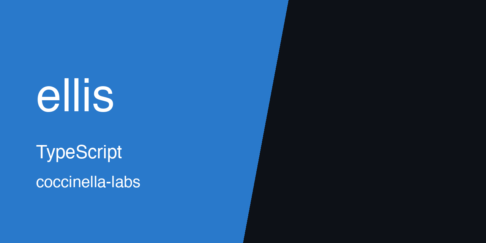

<p align="center">
  
</p>

# ellis

[](https://github.com/coccinella-labs/ellis/actions/workflows/ellis.yml)
[](https://github.com/coccinella-labs/ellis/actions/workflows/validate.yml)
[](https://github.com/coccinella-labs/ellis/actions/workflows/docker.yml)
[](https://github.com/coccinella-labs/ellis/actions/workflows/e2e.yml)
[](https://github.com/coccinella-labs/ellis/actions/workflows/cli.yml)
[](https://github.com/coccinella-labs/ellis/actions/workflows/codeql.yml)
[](https://github.com/coccinella-labs/ellis/actions/workflows/stale.yml)
[](https://github.com/coccinella-labs/ellis/actions/workflows/labeler.yml)
[](https://github.com/coccinella-labs/ellis/actions/workflows/merge.yml)

ellis is an AI-powered text editor that ships as both a web application and a command-line tool. It offers inline AI text completion as you type: suggestions appear as ghost text over your writing, and you press Tab to accept one or Escape to dismiss it. Completions can be generated at three granularities, word, sentence, or paragraph, and in four writing styles, casual, formal, creative, or technical. Mode and style are independent, so a technical paragraph or a casual sentence can be requested without changing anything else about the setup.

The web app is a React single-page application with dark and light themes, a settings panel, and keyboard shortcuts. It runs on an Express server with Vite handling the frontend build and development experience. The CLI provides a simpler, line-based editing workflow through the `fx` command: start a fresh document with `fx new --mode sentence --style casual`, or open an existing file with `fx edit draft.txt --mode paragraph --style technical`. The web app supports Gemini, SambaNova, OpenRouter, and optional AtlasCloud. The CLI currently requires a Gemini API key.

Google Gemini is the primary AI provider, with Gemini 3.8 Flash (`gemini-3.8-flash`) as the default model and Gemini 3.5 Flash-Lite (`gemini-3.5-flash-lite`) as an alternative. SambaNova is the alternative provider, running gpt-oss-120b. OpenRouter is a third provider that uses the free auto-router (`openrouter/free`) to select a free model automatically, so it works without a configured primary model. In auto mode, ellis tries Gemini first when a Gemini API key is configured, then SambaNova on rate-limit or quota-related errors, then OpenRouter if an `OPENROUTER_API_KEY` is configured. If no Gemini API key is configured, auto mode tries SambaNova and then OpenRouter. Other Gemini errors, including timeouts, do not automatically trigger fallback. Explicitly selecting a provider uses that provider without automatic fallback.

To get started, clone the repository with `git clone https://github.com/coccinella-labs/ellis`, move into the directory, copy `.env.example` to `.env`, and add your `GEMINI_API_KEY`. Add `SAMBANOVA_API_KEY` if you want to use SambaNova, `OPENROUTER_API_KEY` if you want to use OpenRouter (required even for its free models), and `ATLASCLOUD_API_KEY` if you want to use the optional AtlasCloud provider. Run `npm install` to fetch dependencies, then `npm run dev` to start the development server, and open `http://localhost:3000`. Suggestions appear after you pause for 500 milliseconds, so the editor stays out of the way while you are actively writing and only offers help when you stop.

Configuration is handled through environment variables. `GEMINI_API_KEY` provides access to Gemini. `SAMBANOVA_API_KEY` enables SambaNova. `DISABLE_GEMINI` skips the Gemini check during the server provider-status check when set to `true`; it does not disable Gemini completion requests. `DATABASE_URL` provides the PostgreSQL connection string used by the Drizzle ORM configuration. `PORT` overrides the default server port of 3000.

The project is written in TypeScript. The frontend uses React 18, Vite 7, Tailwind CSS 3, and Radix UI. The backend is Express 4. Database tooling uses Drizzle ORM with PostgreSQL configuration. The CLI is built with Commander.js. Testing uses Vitest for unit tests and Playwright for browser tests. Docker and Vercel deployment are supported. Useful scripts include `npm run dev`, `npm run build`, `npm run build:cli`, `npm run check` for type checking, `npm run lint`, `npm test`, `npm run test:e2e`, and `npm run preflight` for the combined validation workflow.

Fork the repository, create a feature branch, and run the app locally with `npm run dev` to try a change. Because the web app and CLI share completion concepts but use different interaction models, changes to modes, styles, or provider handling should be checked in both interfaces where applicable. Add or update Vitest and Playwright tests alongside your change, and describe in your pull request which mode, style, interface, and provider path you exercised.

Suggestions depend on a network call to an AI provider, so the editor needs connectivity and a valid API key to be useful. Automatic fallback only triggers on rate-limit or quota-related Gemini errors. A timeout or other general API error does not by itself switch providers. The CLI is a terminal editor intended for headless and lightweight workflows, not a full replacement for the web interface's ghost-text interaction, settings panel, or theming. The server exposes a health check at `/api/health` and provider status at `/api/status`, alongside the completion endpoint at `/api/complete`. It also enforces request size limits and handles graceful shutdown.

Reusable parts of this repository include the shared package at `packages/shared`, which contains Zod schemas, prompt builders, a logger, and Gemini, SambaNova, OpenRouter, and AtlasCloud client wrappers. For example:

```ts
import { textCompletionRequestSchema } from '@shared/schema';
import { logger } from '@shared/logger';
import { generateTextCompletion } from '@shared/gemini';
```

The commit-msg hook in `scripts/commit-msg` enforces a subject line of 80 characters or fewer and, for changes touching more than five files or more than two new tests, requires a body of at least two lines. The `commitlint.config.js` file relaxes the `type-enum` and `subject-case` rules so commit subjects can use natural language, and the README structure is adapted from the original repository template. For example, the commit-msg hook:

```sh
#!/bin/bash
commit_msg=$(head -n1 "$1")
if [ ${#commit_msg} -gt 80 ]; then
  echo "Commit message first line must be <= 80 characters"
  exit 1
fi
```

The rest of the codebase is application-specific.

Maintenance: keep dependencies current with:

```sh
npm update
npm run preflight
```

When upgrading, review these locations: model names in `packages/shared/schema.ts`, `packages/shared/gemini.ts`, `apps/cli/src/gemini.ts`, and `apps/client/src/components/SettingsPanel.tsx`; the package name and bin in `apps/cli/package.json`; environment variables in `.env.example`; and provider endpoints in `packages/shared/sambanova.ts`. Licensed under MIT. See [LICENSE](LICENSE).
